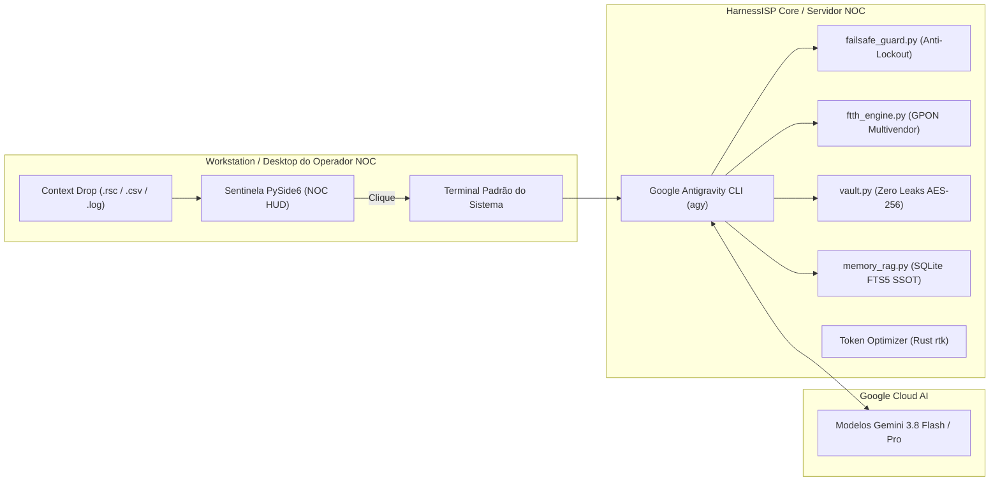

# ⚡ HarnessISP — Sentinela Desktop Inteligente para Redes e Provedores (ISPs)

> **Arquitetura Soberana:** Desktop Sentinela (Workstation do Operador) ⇄ Motor de Redes NOC ⇄ Google Antigravity CLI (`agy`)  
> **Especialidade:** Engenharia de Redes, FTTH/GPON & NOC Operacional  
> **Pilar Central:** Blindagem Anti-Lockout & Sentinela Desktop NOC  
> **Licença:** MIT / Open Source para a comunidade de Provedores de Internet

---

## 🧭 Manifesto de Arquitetura

O HarnessISP na área de trabalho atua como um **HUD Sentinela de alta disponibilidade para engenharia de NOC**:

* **HUD Sentinela NOC & Telemetria em Tempo Real:**
  * **Badge Sentinela Compacto:** Emblema circular dark-glass com topologia de rede centralizada e anel de pulso em tempo real. Identificação visual imediata de estado (Verde Esmeralda = Operação Normal, Ciano = Processamento/Sync, Carmesim = Alerta Crítico / Safe-Mode).
  * **Dynamic Island (NOC Telemetry Mode):** Alternância via duplo-clique para barra horizontal dark-glass com telemetria live do NOC: sessões BGP ativas, latência média (ms), níveis de potência óptica FTTH (dBm) e status do Safe-Mode.
  * **Context Dropping & Ingestão Direta:** Arraste scripts RouterOS (`.rsc`), backups, dumps de OLT ou arquivos de log diretamente sobre o widget para disparar automaticamente a auditoria pré-flight de segurança anti-lockout.
  * **Disparo de Terminal Nativo com 1 Clique:** Clique no widget para abrir instantaneamente o terminal padrão configurado no sistema (**Ghostty, Kitty, Foot, Alacritty, Windows Terminal**) executando a sessão da **Google Antigravity CLI (`agy`)**:
    ```bash
    agy
    ```

---

## 🏗️ Topologia e Divisão de Responsabilidades



| Camada | Ambiente | Responsabilidade Operacional |
| :--- | :--- | :--- |
| **Desktop Sentinela (PySide6)** | Workstation do Operador (Linux / macOS / Windows) | HUD visual de NOC, Dynamic Island, aprovação pré-flight HITL e context drop de scripts. |
| **Workspace & Esteira Central** | Servidor NOC / Estação de Engenharia | Repositório canônico, suíte de testes, base RAG SQLite FTS5, scripts de rollback e cofre AES-256. |
| **Motor de Cognição (Terminal)** | Google Cloud (**Gemini 3.8 Flash / Pro**) via `agy` | Sessão interativa da Google Antigravity CLI no terminal nativo, com skills de ISP e governança via `AGENTS.md`. |

---

## ⚡ Recursos Centrais para Provedores (NOC)

1. **Blindagem Anti-Lockout Inegociável (`core/failsafe_guard.py`):**
   * Detecção preventiva de perda de gerência: regras de `drop` na chain `input` sem `established,related`, alteração de MTU ou corte de rotas padrão.
   * Geração automática de scripts com Safe Mode (`<safe>`) no RouterOS e timers de rollback automático no Linux.
2. **Pílula de Pré-flight Approval (HITL com 1 Clique):**
   * Diálogo flutuante acoplado ao sentinela que intercepta comandos perigosos com botões rápidos: `[🛡️ Safe-Mode (Enter)]`, `[⚡ Forçar]` ou `[❌ Abortar (Esc)]`.
3. **Automação FTTH Multivendor (`core/ftth_engine.py`):**
   * Parsing de `display ont autofind` e cálculo de atenuação óptica (Class B+/C+) para OLTs Huawei, ZTE, Fiberhome e Datacom.
4. **Token Economy Nativa (RTK):**
   * Compressão determinística de tabelas BGP extensas, rotas e logs de syslog antes da injeção no contexto do agente.
5. **Escudo Zero Leaks (`core/vault.py`):**
   * Cofre criptografado com AES-256-GCM e PBKDF2 para credenciais de borda, injetadas estritamente em RAM.

---

## 📁 Estrutura do Repositório

```text
harness-isp/
├── main.py                     # Entrypoint do Desktop Sentinela e disparo do terminal nativo
├── AGENTS.md                   # Contrato de governança, comandos determinísticos e zero leaks
├── requirements.txt            # Dependências pinadas (PySide6, pydantic, cryptography, jc, pytest)
├── README.md                   # Manifesto e documentação do projeto
├── prompt-harness-isp-v3.md    # Especificação master de telecom
├── desktop/                    # Arquivos de atalho XDG (.desktop)
├── systemd/                    # Unit files systemd de usuário
├── core/
│   ├── storage.py              # Gestão do workspace (~/HarnessISP_Data) e backups prévios
│   ├── vault.py                # Cofre AES-256-GCM (Zero Leaks)
│   ├── token_optimizer.py      # Hook e compressor RTK nativo (Rust v1.1.0)
│   ├── memory_rag.py           # Ingestor SQLite FTS5 sincronizado com Markdown
│   ├── reflect.py              # Gerador de notas atômicas pós-incidente (NOTA-XXXX)
│   ├── failsafe_guard.py       # Validador Anti-Lockout e gerador de Safe Mode
│   ├── ftth_engine.py          # Diagnósticos ópticos e provisionamento OLT
│   ├── net_tools.py            # Utilitários de rede (Ping, MTR, DNS, RDAP)
│   ├── session.py              # Máquina de estados do sentinela
│   └── cli_bridge.py           # Ponte oficial com a Google Antigravity CLI (agy)
├── gui/
│   ├── styles.py               # QSS Dark Mode e design system NOC
│   ├── widget.py               # Desktop Sentinela: Badge NOC, Context Drop e Dynamic Island
│   ├── approval_pill.py        # Pílula flutuante de autorização rápida pré-flight
│   └── tray.py                 # Ícone na bandeja do sistema
├── wiki/                       # Base de conhecimento SSOT em Markdown (Obsidian)
└── tests/                      # Suíte de testes automatizados com pytest
```

---

## 🚀 Como Executar

### 1. Iniciar o Sentinela no Desktop (Workstation / Omarchy / Alienware)

O widget é um **HUD gráfico** que roda localmente na sua estação de trabalho (com display Wayland/X11). Ao ser clicado, ele abre automaticamente o seu terminal conectando via SSH ao CT 249 (`harness-isp`) executando a `agy`.

```bash
# Na sua máquina física com tela:
cd ~/harness-isp

# Instalação rápida no menu de aplicativos (Rofi / Walker / Hyprland):
./scripts/install-desktop.sh

# Ou execução direta via uv:
uv run python3 main.py
```
> *Ao clicar no widget, seu terminal padrão (`ghostty`, `kitty`, `foot`, etc.) abrirá instantaneamente na sessão interativa da `agy` no servidor de telecom.*

#### Inicialização Automática no Login (Opcional):
```bash
systemctl --user enable --now harness-isp-companion.service
```

### 2. Acesso Direto via CLI (Headless / SSH)

```bash
# Iniciar a sessão interativa no terminal atual
python3 cli.py chat
```

### 3. Rodar a Suíte de Testes

```bash
source .venv/bin/activate
pytest -v
```

---

## 🧪 Cobertura de Testes Automatizados

* **Desktop Sentinela HUD:** Instanciação, anel de status, alternância Dynamic Island e context dropping de scripts RouterOS.
* **Pre-flight Approval Pill:** Interceptação flutuante, atalhos de teclado e decisões Safe-Mode/Abort.
* **Anti-Lockout Shield:** Detecção de regras suicidas de firewall, MTU e bloqueio de SSH.
* **Cofre Seguro:** Criptografia AES-256-GCM com isolamento contra vazamento de credenciais.
* **Token Economy (RTK):** Resumo sintético de tabelas de BGP, ping ICMP e potências ópticas.
* **FTTH Engine:** Avaliação de níveis ópticos Class B+/C+ e parsing de ONUs.
* **RAG SQLite FTS5:** Indexação e busca atômica de notas técnicas e topologia de POPs.
