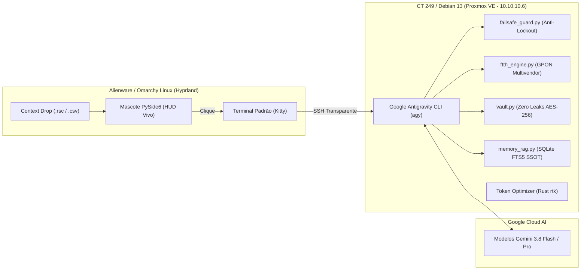

# ⚡ HarnessISP — Desktop Companion Inteligente para Redes e Provedores (ISPs)

> **Arquitetura Soberana:** Desktop Companion (Alienware / Workstation) ⇄ Esteira Central CT 249 (Proxmox VE) ⇄ Google Antigravity CLI (`agy`)  
> **Especialidade:** Engenharia de Redes, FTTH/GPON & NOC Operacional  
> **Pilar Central:** Blindagem Anti-Lockout & Desktop Companion (Inspirado no *Coucou*)  
> **Autoridade:** Bruno Cesar | **Repositório SSOT:** `brncesarms/harness-isp`

---

## 🧭 Manifesto de Arquitetura

O mascote na sua área de trabalho (**Alienware**) funciona como um **HUD / Desktop Companion vivo**:

* **Presença Não-Intrusiva:** Fica flutuando livremente na área de trabalho ou ancorado no topo em formato de **Dynamic Island**.
* **Feedback Visual em Tempo Real:** Expressa visualmente o estado da infraestrutura através de animações táteis e halos dinâmicos:
  * 🟢 **Vigilante / Normal:** Rede estável, latência baixa, respiração calma.
  * 🟡 **Escaneando:** Olhos em varredura de scanner (MTR, Ping, OLT Autofind).
  * 🔴 **Alerta Crítico:** Olhos arregalados e pulsação rápida ao detectar risco de lockout ou atenuação severa de fibra (< -27 dBm).
* **Context Dropping:** Serve como zona de arrastar e soltar direta para scripts `.rsc` do MikroTik, dumps de OLT e logs de BGP para auditoria pré-flight instantânea.
* **Ao ser clicado:** Abre imediatamente o seu terminal padrão (**Kitty**) conectado via SSH diretamente na esteira oficial do **CT 249**:
  ```bash
  ssh -t harness-isp "cd /home/brn/harness-isp && export PATH=$HOME/.local/bin:$PATH && agy"
  ```

---

## 🏗️ Topologia e Divisão de Responsabilidades



| Camada | Host Físico / VM | Responsabilidade Operacional |
| :--- | :--- | :--- |
| **Desktop Companion (PySide6)** | `alienware` (Omarchy Linux / Hyprland) | HUD visual tátil, animação facial, Dynamic Island, aprovação pré-flight e context drop. |
| **Workspace & Esteira Central (SSOT)** | **CT 249** (`harness-isp` Debian 13 no Proxmox) | Repositório canônico, suíte de testes, base RAG SQLite FTS5, scripts de rollback e cofre AES-256. |
| **Motor de Cognição (Terminal)** | Google Cloud (**Gemini 3.8 Flash / Pro**) via `agy` | Sessão interativa da Google Antigravity CLI no terminal nativo, com skills de ISP e governança via `AGENTS.md`. |

---

## ⚡ Recursos Centrais para Provedores (NOC)

1. **Blindagem Anti-Lockout Inegociável (`core/failsafe_guard.py`):**
   * Detecção preventiva de perda de gerência: regras de `drop` na chain `input` sem `established,related`, alteração de MTU ou corte de rotas padrão.
   * Geração automática de scripts com Safe Mode (`<safe>`) no RouterOS e timers de rollback automático no Linux.
2. **Pílula de Pré-flight Approval (HITL com 1 Clique):**
   * Diálogo flutuante acoplado ao companion que intercepta comandos perigosos com botões rápidos: `[🛡️ Safe-Mode (Enter)]`, `[⚡ Forçar]` ou `[❌ Abortar (Esc)]`.
3. **Automação FTTH Multivendor (`core/ftth_engine.py`):**
   * Parsing de `display ont autofind` e cálculo de atenuação óptica (Class B+/C+) para OLTs Huawei, ZTE, Fiberhome e Datacom.
4. **Token Economy Nativa (RTK):**
   * Compressão determinística de tabelas BGP extensas, rotas e logs de syslog antes da injeção no contexto do agente.
5. **Escudo Zero Leaks (`core/vault.py`):**
   * Cofre criptografado com AES-256-GCM e PBKDF2 para credenciais de borda, injetadas estritamente em RAM.

---

## 📁 Estrutura do Repositório

```text
harness-isp/
├── main.py                     # Entrypoint do Desktop Companion e disparo do terminal CT 249
├── AGENTS.md                   # Contrato de governança, comandos determinísticos e zero leaks
├── requirements.txt            # Dependências pinadas (PySide6, pydantic, cryptography, jc, pytest)
├── README.md                   # Manifesto e documentação do projeto
├── prompt-harness-isp-v3.md    # Especificação master de telecom
├── core/
│   ├── storage.py              # Gestão do workspace (~/HarnessISP_Data) e backups prévios
│   ├── vault.py                # Cofre AES-256-GCM (Zero Leaks)
│   ├── token_optimizer.py      # Hook e compressor RTK nativo (Rust v1.1.0)
│   ├── memory_rag.py           # Ingestor SQLite FTS5 sincronizado com Markdown
│   ├── reflect.py              # Gerador de notas atômicas pós-incidente (NOTA-XXXX)
│   ├── failsafe_guard.py       # Validador Anti-Lockout e gerador de Safe Mode
│   ├── ftth_engine.py          # Diagnósticos ópticos e provisionamento OLT
│   ├── net_tools.py            # Utilitários de rede (Ping, MTR, DNS, RDAP)
│   ├── session.py              # Máquina de estados do companion
│   └── cli_bridge.py           # Ponte oficial com a Google Antigravity CLI (agy)
├── gui/
│   ├── styles.py               # QSS Dark Mode e design system NOC
│   ├── widget.py               # Desktop Companion: Mascote com olhos expressivos, Context Drop e Dynamic Island
│   ├── approval_pill.py        # Pílula flutuante de autorização rápida pré-flight
│   └── tray.py                 # Ícone na bandeja do sistema
├── wiki/                       # Base de conhecimento SSOT em Markdown (Obsidian)
└── tests/                      # Suíte de testes automatizados com pytest (20 testes)
```

---

## 🚀 Como Executar

### 1. Iniciar o Companion no Desktop (Workstation / Alienware)

```bash
# Executa o launcher nativo
harness-isp
```
> *Ao clicar no mascote, o Kitty abre instantaneamente na esteira do CT 249 rodando a `agy`.*

### 2. Acesso Direto via Terminal

```bash
# Conexão transparente com a esteira do CT 249
ssh -t harness-isp "cd /home/brn/harness-isp && agy"
```

### 3. Rodar a Suíte de Testes

```bash
# Executado dentro do repositório
source .venv/bin/activate
pytest -v
```

---

## 🧪 Cobertura de Testes Automatizados (20/20)

* **Coucou-Style Companion:** Instanciação, física elástica, alternância Dynamic Island e renderização facial.
* **Pre-flight Approval Pill:** Interceptação flutuante, atalhos de teclado e decisões Safe-Mode/Abort.
* **Anti-Lockout Shield:** Detecção de regras suicidas de firewall, MTU e bloqueio de SSH.
* **Cofre Seguro:** Criptografia AES-256-GCM com isolamento contra vazamento de credenciais.
* **Token Economy (RTK):** Resumo sintético de tabelas de BGP, ping ICMP e potências ópticas.
* **FTTH Engine:** Avaliação de níveis ópticos Class B+/C+ e parsing de ONUs.
* **RAG SQLite FTS5:** Indexação e busca atômica de notas técnicas e topologia de POPs.
